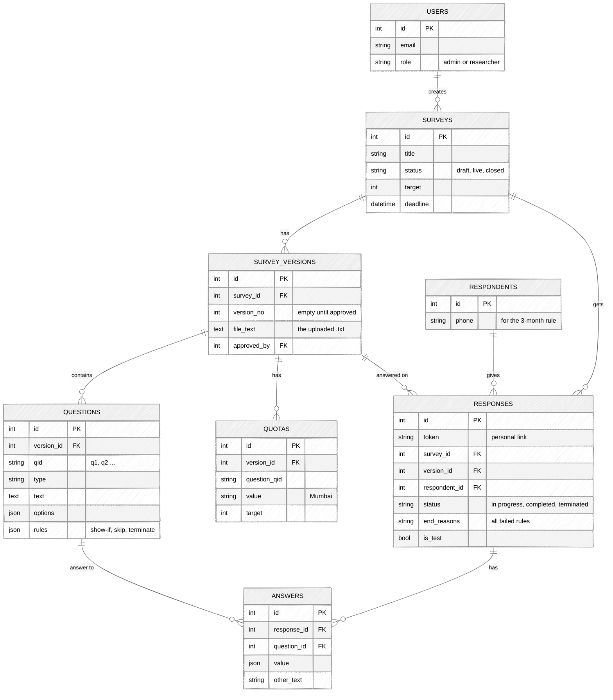

# Database Design

## In plain words

- A **survey** has one or more **versions**. Each version is one uploaded `.txt` file. It gets a
  version number only when an admin approves it, and after that it never changes.
- A version's **questions** and **quotas** are stored as rows, so the same code can show any survey.
- A **respondent** is one person, known by their phone number. This gives us the 3-month rule and
  "one link per person".
- A **response** is one respondent's attempt at one survey. It remembers which version they
  answered, so someone halfway through version 1 can finish on version 1 even after version 2 is out.
- Every **answer** is its own row, saved the moment it is given. If a phone dies at q14, q1 to q13
  are already saved.
- Test runs from preview are marked `is_test` and never counted.
