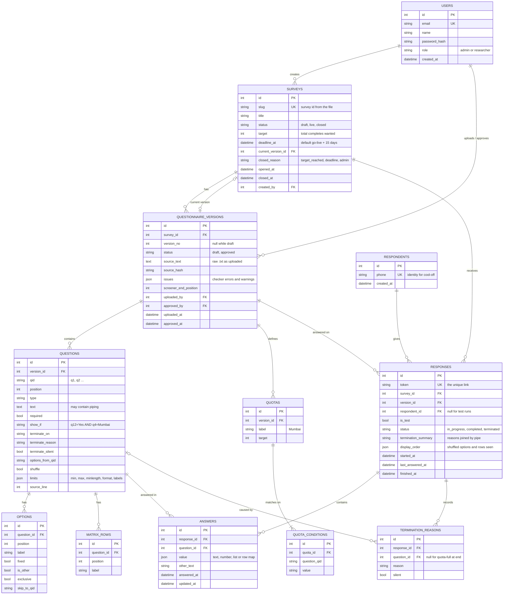

# Database Design

SQLite (via SQLAlchemy). The diagram source is [`diagrams/06_database.mmd`](diagrams/06_database.mmd).

## How the tables fit together

| Group | Tables | Idea |
|---|---|---|
| Staff | `users` | One table, `role` = admin or researcher. |
| Survey definition | `surveys` → `questionnaire_versions` → `questions` → `options`, `matrix_rows`; `quotas` → `quota_conditions` | A survey is the long-lived project (status, target, deadline). Each upload is a version row. The parsed file is stored as rows so the same code renders every survey. |
| People | `respondents` | One row per phone number. Used for the 3-month cool-off and "one link per person per survey". |
| Answers | `responses` → `answers`, `termination_reasons` | One response = one person's attempt at one survey. One answer row per question, written the moment it is given. |

## Key rules the schema enforces

- **Versions are immutable once approved.** Re-uploading before approval overwrites the draft row.
  Approval sets `version_no = max + 1`, and the questions, options and quotas of that version are
  never edited again. `source_text` keeps the exact file that was approved.
- **Every response records its version** (`responses.version_id`). A respondent mid-way through v1
  stays on v1 after v2 is approved. Export adds a `Version` column.
- **One response per person per survey:** unique (`survey_id`, `respondent_id`). Reopening the
  link resumes it, or shows "Already completed".
- **One answer per question per response:** unique (`response_id`, `question_id`). Going Back and
  changing an answer updates the row (`updated_at`), so nothing is lost or duplicated.
- **Test runs never count:** `is_test = true`, no respondent row. They are excluded from
  dashboards, quotas, exports and the cool-off rule.
- **Quotas count across versions.** A quota group is matched by question id + value
  (`quota_conditions`) over completed, non-test responses of the survey, whatever version they
  answered. Several conditions on one quota give nested quotas (Mumbai + Male = 25).
- **Termination keeps every reason:** one `termination_reasons` row each (for the dashboard
  counts) plus `termination_summary` joined by `|` (for the export).
- **Shuffled order is saved** in `responses.display_order`, so Back and resume show the same order.

## Why rows instead of one JSON blob per version

Answers point at a real `questions.id`, so exports, dashboards and drop-off reports are plain SQL
joins, and a deleted or mistyped question can never silently orphan answers. The raw `.txt` is
still stored, so any version can be re-parsed or downloaded exactly as approved.
