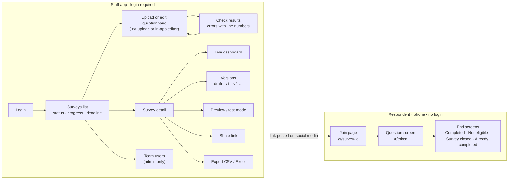
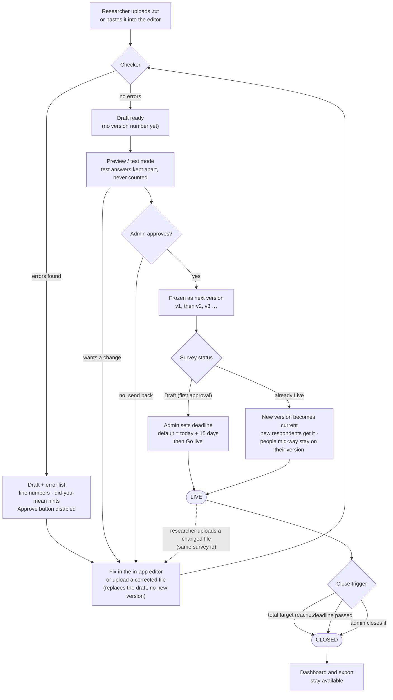
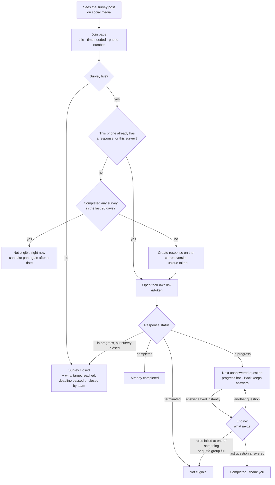
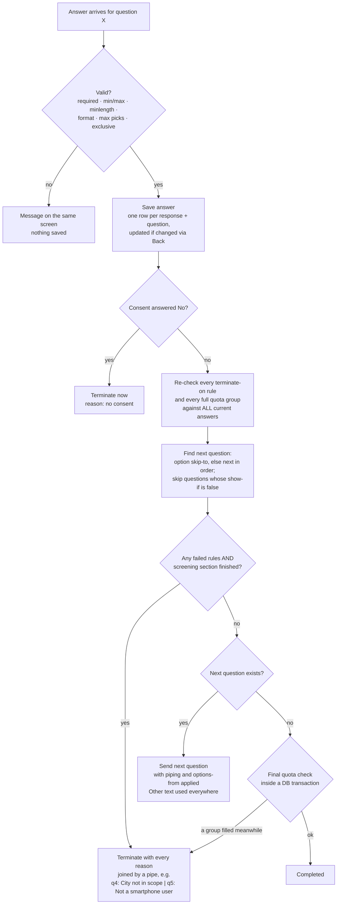
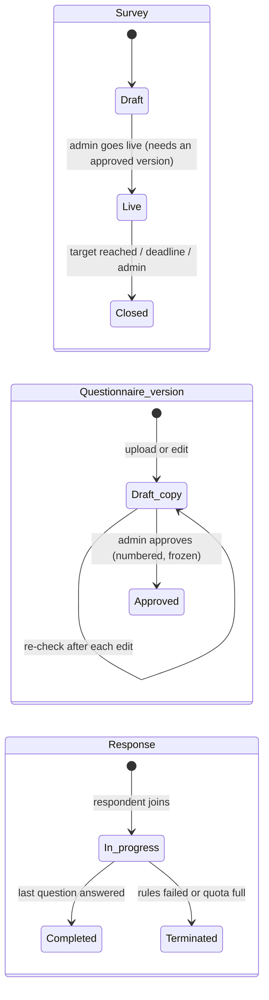

# User Flow

Main screens, who uses them, and the steps a survey and a respondent go through.
Diagram sources live in [`diagrams/`](diagrams/) (`.mmd`); GitHub renders the blocks below.

## 1. Screen map

Two apps in one frontend: a **staff app** (login: Admin or Researcher) and a **respondent app**
(phone-first, no login, reached by link).

## 2. Life of a survey (staff side)

Uploads and edits before approval only change the **draft**. A version number (v1, v2, ...) is
given **only when an admin approves**, and an approved version is frozen forever.

| Step | Researcher | Admin |
|---|:---:|:---:|
| Upload / edit questionnaire, see check results | ✅ | ✅ |
| Preview and test mode | ✅ | ✅ |
| Approve a draft (freeze as a version) | ❌ | ✅ |
| Go live, set or extend the deadline, close a survey | ❌ | ✅ |
| Dashboard and export | ✅ | ✅ |
| Manage team users | ❌ | ✅ |

## 3. Respondent journey (phone)

End screens: **Completed**, **Not eligible**, **Survey closed** (with the reason), **Already
completed**, and **Not eligible right now** (3-month cool-off).

## 4. What happens after every answer (the engine)

One backend function decides the next step from the saved answers, so the phone keeps no state
and a refresh or a dead battery loses nothing.

**Screening section** = every question up to and including the last question that has a
`terminate-on` rule or a quota. For the sample file that is q0 to q5. Failed rules are collected
while the person is in the screening section, and they are ended once it is over, so every reason
is saved (`q4: City not in scope | q5: Not a smartphone user`). Consent "No" ends at once.

## 5. Statuses

