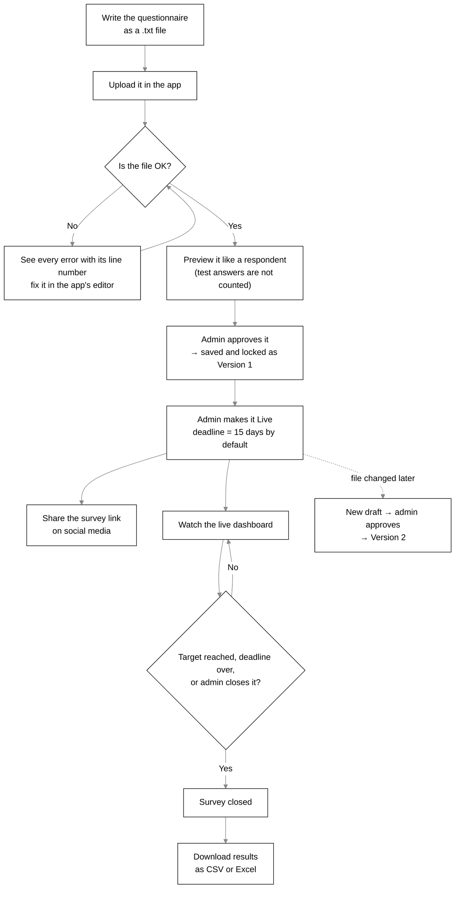
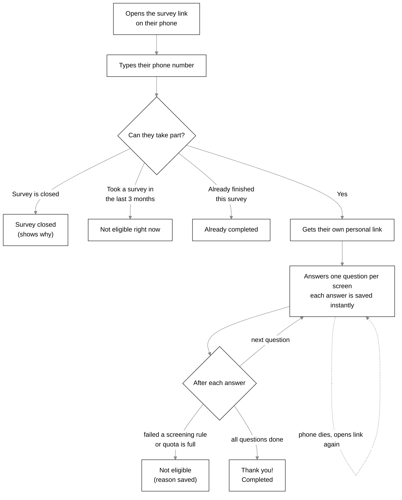
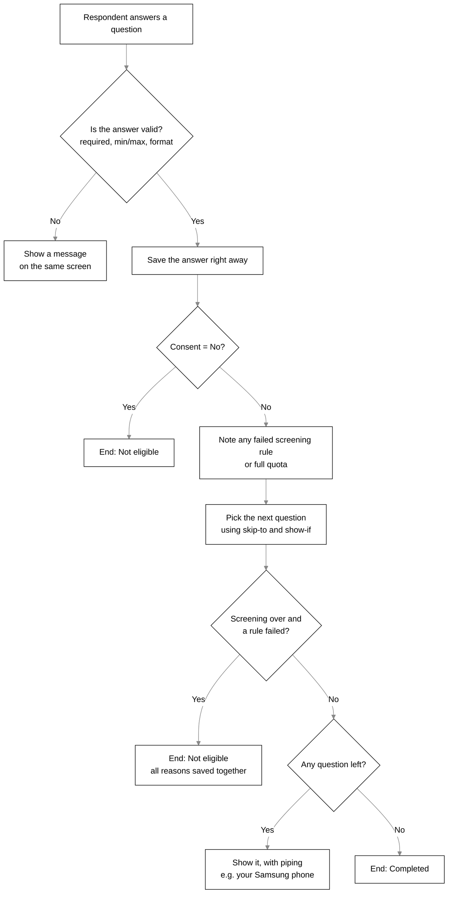

# User Flow

There are two kinds of people in this app:

- **The research team** logs in. A **researcher** uploads, fixes and previews surveys. An
  **admin** can do all of that, and also approves surveys, puts them live and closes them.
- **The respondent** never logs in. They open a link on their phone and answer.

## 1. Research team

A survey is **Draft** until an admin approves it and puts it live, then **Live**, then **Closed**.
A version number is given only when an admin approves. Before that, every upload or fix just
updates the same draft.

## 2. Respondent (on a phone)

A response is always **In progress**, **Completed** or **Terminated**.

## 3. What happens after each answer

- **Skip-to and show-if** decide which question comes next.
- **Piping** puts an earlier answer into the text ("How happy are you with your *Samsung* phone?").
- **Screening:** while the person is in the first few screening questions, every failed rule is
  noted. When screening ends, they are stopped with all the reasons together
  (`q4: City not in scope | q5: Not a smartphone user`). Consent "No" stops them at once.
